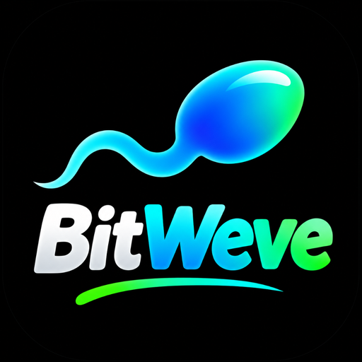

# BitWeve Ultimate — Simulador de Vida Real

<p align="center">
  
</p>

<p align="center">
  <b>Simulador de vida profundo, 100% interativo, visualmente profissional e offline para Android e iOS.</b><br/>
  Desenvolvido em Flutter e Dart com persistência local em SQLite nativo (Drift).
</p>

<p align="center">
  <a href="https://github.com/Gabriel-HRsouza/Bitweve/raw/main/release/BitWeve-v1.2.0.apk">
    
  </a>
  <a href="https://github.com/Gabriel-HRsouza/Bitweve/releases">
    
  </a>
</p>

---

## 📱 Como Baixar e Instalar no Celular Android

### Método Recomendado: Download Direto (Super Fácil)
1. **Baixe o arquivo diretamente no seu celular:**  
   👉 **[Clique aqui para Baixar o BitWeve v1.2.0 APK](https://github.com/Gabriel-HRsouza/Bitweve/raw/main/release/BitWeve-v1.2.0.apk)**  
   *(Também disponível na pasta `release/BitWeve-v1.2.0.apk` neste repositório ou na aba [Releases](https://github.com/Gabriel-HRsouza/Bitweve/releases))*.
2. Ao concluir o download, abra o arquivo baixado (`BitWeve-v1.2.0.apk`) pela barra de notificações ou pelo gerenciador de arquivos do celular.
3. Se o Android solicitar autorização para instalar de fontes desconhecidas pelo navegador, toque em **Permitir desta fonte**.
4. Toque em **Instalar** e abra o jogo! Todos os sistemas funcionam 100% offline e gratuitamente.

*Observação para desenvolvedores:* Caso clone o código e compile manualmente, o instalador gerado ficará em:  
`build/app/outputs/flutter-apk/app-release.apk`

---

### No iOS (iPhone / iPad)

Devido às políticas e certificados exigidos pela Apple, aplicativos fora da App Store precisam ser compilados ou distribuídos via TestFlight ou ferramentas de assinatura pessoal.

#### Opção A: Compilar via Xcode (para desenvolvedores ou com Mac)
1. Clone este repositório no seu Mac:
   ```bash
   git clone https://github.com/Gabriel-HRsouza/Bitweve.git
   cd Bitweve
   ```
2. Instale as dependências:
   ```bash
   flutter pub get
   ```
3. Abra o projeto no Xcode:
   ```bash
   open ios/Runner.xcworkspace
   ```
4. Na aba **Signing & Capabilities**, selecione seu **Team** (conta gratuita de desenvolvedor Apple).
5. Conecte seu iPhone via cabo ou Wi-Fi e clique no botão **Run** (Play) no Xcode para instalar diretamente no aparelho.

#### Opção B: Instalação via TestFlight / AltStore
Se você utiliza AltStore ou Sideloadly no Windows ou Mac:
1. Gere o pacote de compilação sem assinatura:
   ```bash
   flutter build ios --release --no-codesign
   ```
2. Empacote o arquivo `Runner.app` em formato `.ipa`.
3. Envie para o dispositivo através do AltStore ou Sideloadly com seu Apple ID pessoal.

---

## Principais Sistemas do Jogo

- **Persistência Local Real**: O jogo utiliza SQLite nativo via Drift. Todo o progresso fica salvo na memória privada do celular, mantendo as vidas e decisões salvas após fechar ou reiniciar o aparelho. Os dados só são apagados se o aplicativo for desinstalado.
- **Motor Central de Envelhecimento**: O botão de avançar um ano calcula passagem de tempo, salários, despesas, impostos, saúde, estresse, reputação e eventos aleatórios com efeitos sonoros hápticos e sonoros em todos os botões.
- **Saúde Avançada & Neurodesenvolvimento**: Representação clínica individualizada de TEA, TDAH, Dislexia, Depressão, Ansiedade, Bipolaridade, Diabetes, Asma e Hipertensão. Acesso ao SUS, planos de saúde particulares, consultas com especialistas, psicoterapia e farmácia.
- **Mercado Cripto & Bolsa**: Gráficos dinâmicos interativos com Bitcoin (BTC), Ethereum (ETH) e BitWeve Token (BWV), com ordens de compra e venda em tempo real e volatilidade calculada anualmente.
- **Concessionária & Garagem**: Catálogo completo com motocicletas, sedãs, SUVs blindados, esportivos, iates e jatos, com gestão de manutenção anual, seguros e revenda.
- **Empreendedorismo & Startups**: Fundação de empresas de tecnologia, restaurantes e agências. Contratação de equipes, investimentos em marketing, valuation dinâmico e realização de lucro via venda da empresa (Exit).
- **Escola Jogável**: Escola real (pública, particular ou internacional) com desempenho, popularidade, relação com professores, faltas, advertências, suspensões, extracurriculares, grupos escolares, eventos, baile, enfermaria, provas com questões e professores interativos.
- **Faculdade Completa**: Escolha de instituição (pública, particular, elite, EAD) e curso, mensalidade, bolsas, provas, trabalhos em grupo, TCC, festas, clubes (atlética, empresa júnior, pesquisa), intercâmbio, estágios, reprovação, abandono e formatura — em quatro abas: Curso, Atividades, Colegas e Carreira.
- **Colegas e Personagens Únicos**: Milhares de combinações de nomes; cada NPC tem personalidade (12 tipos), interesses, popularidade, manias, humor e histórico. A personalidade decide se a pessoa aceita, recusa, fica feliz, irritada ou desconfortável.
- **Interações Profundas**: Conversar, elogiar, brincar, presentear, chamar para sair, convidar para festas, acordar, flertar, namorar, casar, pedir desculpas, reconciliar, discutir, bloquear/desbloquear e editar apelido. Romance só entre adultos ou entre adolescentes de idade próxima; momentos íntimos são exclusivos de adultos, com consentimento e sem conteúdo explícito.
- **App de Namoro “Faísca” (18+)**: Perfis com fotos, bio, interesses e objetivos; compatibilidade por interesses, personalidade, idade, status, objetivos e histórico; curtidas, super curtidas, matches recíprocos, chat com reações, encontros, desfazer match e bloqueio.
- **Rede Social “Pulso”**: 13 categorias de posts com imagens, legendas, curtidas, comentários (com resposta), compartilhamentos, seguidores, verificação, tendências do ano, mensagens diretas, publis de marcas, posts virais e polêmicas.
- **Festas Interativas**: Planejador em etapas (tipo, local, convidados, orçamento, decoração, comida, música, atividade) com incidentes aleatórios, reação individual de cada convidado e fotos para o Pulso.
- **Imóveis Administráveis**: Casas, apartamentos, coberturas, mansões, imóveis comerciais; ilustração de cada imóvel, bairro, tamanho, estado, decoração (6 estilos), aluguel, reforma, mudança e festas.
- **Submundo com Minigames**: Crimes fictícios e abstratos, cada um com minigame próprio — Labirinto (furto, estilo arena com perseguidores), Lábia (golpes/negociação), Cofre, Memória (crimes financeiros) e Fuga (contrabando). Catálogo procedural de 1.000 lojas fictícias com fachada ilustrada, organizações com cargos e missões, mercado clandestino, notoriedade e atenção policial.
- **Justiça e Prisão**: Prisão em flagrante, fiança, escolha de advogado, declaração de culpa/inocência, julgamento, multa, condicional ou pena; tela de prisão com rotina (treino, estudo, trabalho com remição, reabilitação, brigas), colegas de cela, recurso e audiência de condicional. Consequências na carreira, estudos e família.
- **Barra de Status Permanente**: Avatar, nome, idade, situação, saldo, patrimônio e indicadores (saúde, estresse, prisão, processo, polícia, relacionamento e mensagens) em todas as telas.
- **Modo Deus Gratuito (God Mode)**: Painel acessível pelo ícone de raio dourado na AppBar para injeção de fundos, manipulação livre de atributos, milagre da cura total, indulto judicial e vitória garantida na loteria.
- **Avatar Dinâmico com Expressões**: Sistema próprio de avatar vetorial procedural que reflete as emoções do protagonista (felicidade, tristeza, raiva, surpresa, doença, amor e medo).
- **Relações Familiares e NPCs Autônomos**: Pais, parentes e amigos envelhecem de forma sincronizada com o protagonista, possuem profissões e emoções próprias, e reagem a interações.
- **Morte e Modo Dinastia**: Ao falecer, o jogador pode visualizar o epitáfio completo da vida e continuar jogando como herdeiro direto para perpetuar o patrimônio da família por gerações.
- **Múltiplos Saves**: Gerenciador de vidas que permite criar e alternar entre diferentes personagens a qualquer momento.

---

## Estrutura da Arquitetura

O projeto foi organizado segundo os padrões de Clean Architecture modular:

- `lib/core/database/`: Definições das tabelas relacionais do Drift e serviço de persistência transacional SQLite.
- `lib/core/router/`: Configuração de navegação declarativa com GoRouter.
- `lib/core/theme/`: Sistema de cores, tipografia (Outfit) e temas claro e escuro.
- `lib/core/audio/`: Controle de efeitos sonoros, feedback tátil e preferências de som.
- `lib/features/character/`: Modelagem de atributos, criação de personagem e renderização vetorial de avatares.
- `lib/features/life_engine/`: Motor central de vida, cálculo de probabilidades, histórico e envelhecimento.
- `lib/features/relationships/`: Gestão de NPCs, interações e dinâmicas familiares.
- `lib/features/education/`: Escolas, cursos universitários e diplomas.
- `lib/features/careers/`: Ocupações, entrevistas, aumentos e promoções.
- `lib/features/finances/`: Saldo bancário, fluxo de caixa e cotações de investimentos.
- `lib/features/properties/`: Inventário de bens, imóveis e veículos.
- `lib/features/events/`: Repositório de eventos aleatórios e ramificações de escolha.
- `lib/features/settings/`: Gerenciador de múltiplos arquivos de save e configurações gerais.
- `lib/features/school/`: Vida escolar e universitária (catálogos e tela de escola/faculdade).
- `lib/features/dating/`: App de namoro Faísca.
- `lib/features/social_media/`: Rede social Pulso.
- `lib/features/parties/`: Planejador e resultados de festas.
- `lib/features/underworld/`: Crimes, 1.000 lojas procedurais, organizações, julgamento e prisão.
- `lib/features/minigames/`: Minigames (labirinto, lábia, cofre, memória, fuga e provas).
- `lib/features/life_engine/systems/`: Um sistema por domínio (`school_system`, `underworld_system`, `social_media_system`, `dating_system`, `party_system`...), todos ligados à passagem de ano.
- `lib/shared/ui/scene_art.dart`: Ilustrações procedurais de lojas, imóveis, escolas e fotos.
- `tools/generate_audio_v3.py`: Síntese dos novos efeitos sonoros (coleta, alarme, match, cela, festa, swipe).

---

## Como Rodar em Ambiente de Desenvolvimento

### Pré-requisitos
- Flutter SDK (versão 3.20 ou superior)
- Dart SDK (versão 3.4 ou superior)
- Android Studio ou VS Code configurado

### Passos
1. Clone o repositório:
   ```bash
   git clone https://github.com/Gabriel-HRsouza/Bitweve.git
   cd Bitweve
   ```

2. Instale as dependências:
   ```bash
   flutter pub get
   ```

3. Gere os códigos do banco de dados (Drift):
   ```bash
   dart run build_runner build --delete-conflicting-outputs
   ```

4. Execute o projeto:
   ```bash
   flutter run
   ```

5. Para rodar os testes automatizados:
   ```bash
   flutter test
   ```

---

## Licença

Projeto desenvolvido para fins de entretenimento e simulação interativa. Todos os direitos reservados.
